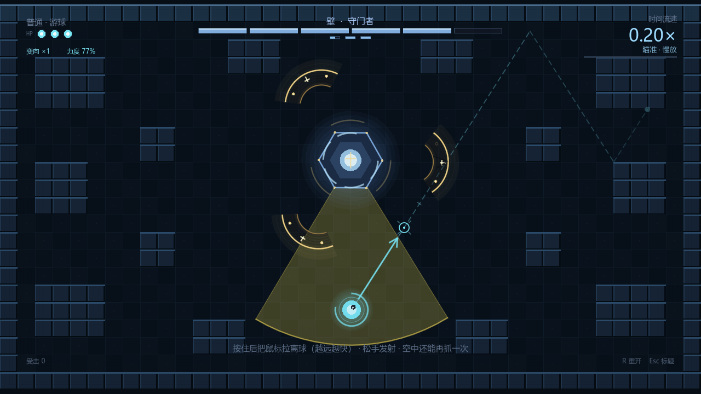
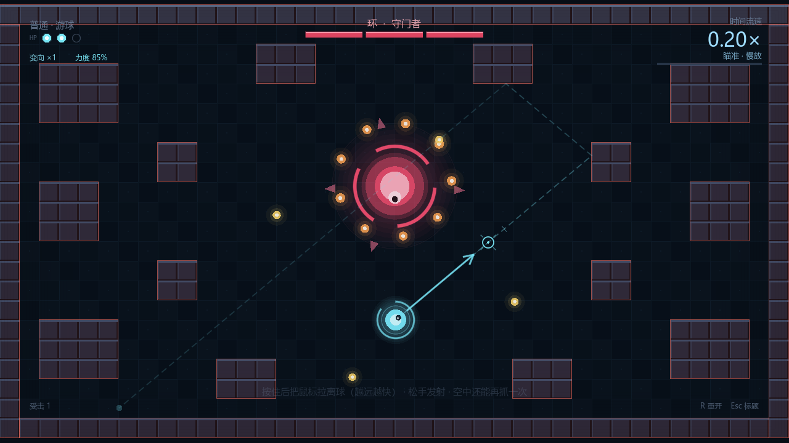

# SLOWBALL

> The world runs at 0.1× speed — until you hold the mouse, when time snaps back to normal.
> You are a ball. Your only weapon is ramming.

A top-down bullet-hell action prototype made with **Godot 4.7 + GDScript**.
**Zero art dependencies**: every visual is drawn in code with circles and lines, CJK text uses system fonts,
and all sound effects are procedurally generated WAVs.


---

## Features

- **Slingshot control** — one drag = one launch. The ball does not follow the mouse:
  direction = ball → cursor, power = drag distance.
- **Time is the resource** — world runs at 0.1× while aiming and 1.0× while flying
  (the bug ball can push it to 0.05×).
- **Three characters**
  - **RANGER** — standard speed; every bounce grants **+2% max speed**, up to 20 stacks (+40%),
    held for 4 s, then decays one stack every 0.2 s.
  - **AEGIS** — 0.9× speed, heavier bounce loss; hold RMB for an arc shield that blocks 4 shots
    and is refilled by catching bullets on its green arc.
  - **INSTAR** — 70% size, 5 mid-air redirects; hold RMB to slow the world to 0.05×
    (max duration ×1.3 per evolution tier). 5 bumps evolve one tier; at max tier it gains
    a damage-absorbing shield, a tearing impact effect and a 20% speed surge.
- **Two bosses** — "Ring" (3 HP, ring bullets + four-way counter) and
  "Wall" (6 HP, 3 orbiting arc shields + fast rectangular rail shots + contact slow).
- **TileMap arena** — paint the `Walls` layer in the editor and collision is generated from the
  cells automatically. Press **F3** in game to visualise the collision boxes.
- **Guide trail** — while aiming, an invisible ball with identical stats is simulated for 1.5 s
  and its path is drawn as a tapering trail.
- **Chinese / English UI** — switch at the top-right of the title screen or press `L`; the choice
  is remembered.
- **Hand-drawn art pipeline** — drop PNGs into `assets/sprites/` to reskin; anything missing falls
  back to code-drawn visuals.

## Screenshots

| | |
| --- | --- |
|  |  |
| Guide trail (real simulated bounce path) | AEGIS shield, 4-shot durability |
|  |  |
| Chapter II "Wall" with arc shields | Rectangular rail shot with gold→brown particles |
|  |  |
| Pause (after focus loss: click + 3 s countdown) | F3 hitbox debug view |

---

## Running

Requires **Godot 4.7** (GL Compatibility renderer, 1280×720).

```bash
# open in the editor and press F5
godot --path .

# or launch straight from the command line
godot --path . --resolution 1280x720
```

> Open the project once in the editor first so Godot can import assets
> (`.godot/` is not committed).

## Controls

| Input | Effect |
| --- | --- |
| **Hold LMB** | Aim: world drops to **0.1×**, the ball keeps flying at its current speed |
| **Move mouse** | Vector starts at the ball's centre (direction = ball→cursor, power = distance) |
| **Release** | Launch along that vector; world returns to **1.0×** |
| **Hold LMB mid-air** | Spend one redirect charge to re-aim while still moving |
| **RMB** (AEGIS) | Hold to keep the shield up (max 1.5 s, blocks 4 shots); release to recharge |
| **RMB** (INSTAR) | Push the world to **0.05×** (limited charge); 5 bumps per evolution tier |
| Bounce off walls / obstacles | Reflect and **bank one redirect** |
| Ram a boss | Deal 1 damage, get knocked back, **bank one redirect** |
| `1` `2` `3` | Pick difficulty |
| `Q` / `E` | Change character |
| `L` | Toggle Chinese / English |
| `Space` | Start; in battle = pause / resume (resume runs a 3 s countdown) |
| `R` / `Esc` | Restart / back to title |
| `F3` | Toggle map hitbox overlay |
| Lose window focus | Auto-pause; on return, **click once**, wait out the 3 s countdown |

---

## Design rules

- **Attacking = ramming**, 1 damage per hit. Difficulty only changes your HP and the number of
  boss counter-arrows; boss HP and bullet speeds stay identical across difficulties.
- **Flying = world at 1.0×; aiming = world at 0.1×.** If you don't move, the world barely moves.
- **Mid-air redirects are limited** (3 by default, 5 for INSTAR); walls, obstacles and bosses each
  bank one. Every launch is a commitment — aim well, commit hard.

Full mechanics and tuning notes: [`docs/大纲.md`](docs/大纲.md) (Chinese).

---

## Project layout

```
slowball/
├─ project.godot            project settings (1280×720, GL Compatibility)
├─ scenes/
│  ├─ main.tscn             World(Bullets/Obstacles/Entities/FX) + UI(HUD)
│  ├─ player.tscn           player (Area2D + CircleShape2D)
│  ├─ boss.tscn / boss2.tscn
│  ├─ bullet.tscn
│  ├─ arena.tscn            TileMapLayer arena (Floor + Walls, map data stored in the scene)
│  └─ tileset.tres          32 px tileset (4 floor + 4 wall + 2 wall-top)
├─ scripts/
│  ├─ config.gd             every tunable value and colour (balance lives here)
│  ├─ main.gd               state machine / time scale / pause / flow
│  ├─ player.gd             launch, redirects, bounces, shield, evolution, guide sim
│  ├─ boss.gd               boss 1 "Ring"
│  ├─ boss2.gd              boss 2 "Wall"
│  ├─ plate.gd              "Wall" orbiting arc shields
│  ├─ bullet.gd             bullets (4 kinds incl. rectangular rail shots)
│  ├─ arena.gd              TileMap → merged collision rectangles
│  ├─ fx.gd                 particles / shockwaves / tears
│  ├─ hud.gd                title, battle HUD, results, pause (all immediate-mode)
│  ├─ sfx.gd                pooled sound player
│  ├─ skins.gd              art pipeline (use image if present, else draw in code)
│  ├─ i18n.gd               Chinese / English strings
│  └─ selftest.gd           101 in-engine checks
├─ assets/
│  ├─ tiles.png             32 px tile atlas
│  ├─ sfx/                  13 procedurally generated sounds
│  └─ sprites/              drop hand-drawn art here (see README in that folder)
├─ tools/                   dev scripts (sfx / art templates / map bake)
├─ docs/大纲.md              design document (Chinese)
└─ shots/                   generated screenshots (--shot=NAME)
```

## Dev commands

```bash
# in-engine mechanics test (headless, 101 checks)
godot --headless --path . -- --selftest

# take screenshots (needs a window)
godot --path . --resolution 1280x720 -- --shot=title|play|shield|boss2|rail|pause|resume|collision|bug

# regenerate the procedural sound effects
godot --headless --path . --script res://tools/make_sfx.gd

# generate correctly-sized blank art templates (with guide outlines)
godot --headless --path . --script res://tools/make_art_templates.gd

# WARNING: reset arena.tscn's map back to the scripted default layout (overwrites your painting)
godot --headless --path . --script res://tools/bake_arena.gd
```

## Asset pipeline

- **Art** — drop PNGs into `assets/sprites/` named as described in
  [`assets/sprites/README.md`](assets/sprites/README.md); anything missing falls back to code drawing.
- **Audio** — overwrite `assets/sfx/*.wav` with files of the same name.
- **Map** — open `scenes/arena.tscn` in the editor and paint the `Floor` / `Walls` layers.
  Collision is built at runtime by merging wall cells into rectangles.

## License

[MIT](LICENSE)
